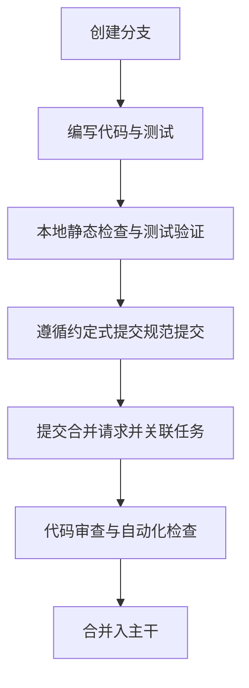

# 贡献指南

感谢参与本项目建设。为保证跨技术栈工程质量、资产一致性与团队协作效率，所有贡献者**必须**遵守本指南中约定的规范流程。

## 协作流程

项目默认以合并请求方式协作，**禁止**直接向主分支推送提交。



## 提交信息规范

代码提交**必须**遵循约定式提交规范，严格采用 `<type>(<scope>): <中文简述>` 结构：

- **类别**限定为以下枚举值：
  - `feat`: 新增功能特性或资产
  - `fix`: 缺陷修复
  - `docs`: 仅文档或注释变更
  - `refactor`: 重构（无功能变更且非缺陷修复的代码调整）
  - `test`: 增加或更新测试用例
  - `chore`: 构建系统或辅助工具变动
- **范围**说明变更模块（例如 `cli`, `manifest`, `labels`, `ruleset`, `gitignore` 等）
- **简述**必须清晰表达修改意图，首字母不使用大写，末尾不使用标点符号

示例：

```text
feat(cli): 支持基于清单配置文件声明式同步规范资产
fix(gitignore): 修复重复追加注释导致的空块问题
docs(readme): 更新命令行工具使用说明
```

## 本地开发与质量验证

提交合并请求前，**必须**确保本地通过所处技术栈的官方静态检查与单元测试：

- **Rust 项目**：执行 `cargo clippy --all-targets` 与 `cargo test`
- **Python 项目**：执行 `uv run ruff check` 与 `uv run pytest`
- **TypeScript 项目**：执行 `bun check` 与 `bun test`
- **文档与配置**：若涉及 Markdown 修改，必须执行格式规范检查与离线死链校验

## 完成定义

合并请求处于可合入状态前，**必须**满足以下全部条件：

1. **类型与静态分析**：对应技术栈静态检查零警告、零报错。
2. **测试覆盖**：新增或修改的核心业务逻辑必须具备对应的自动化测试用例，且全量测试通过。
3. **架构正交**：若涉及规范资产增删，必须通过声明式清单维护，禁止在业务逻辑中硬编码文件路径。
4. **日志输出标准**：自动化工具输出必须保持纯英文、无表情符号、以行格式为智能体友好解析。
5. **文档同步**：功能、接口或规则变更必须同步更新说明文档与变更日志。
